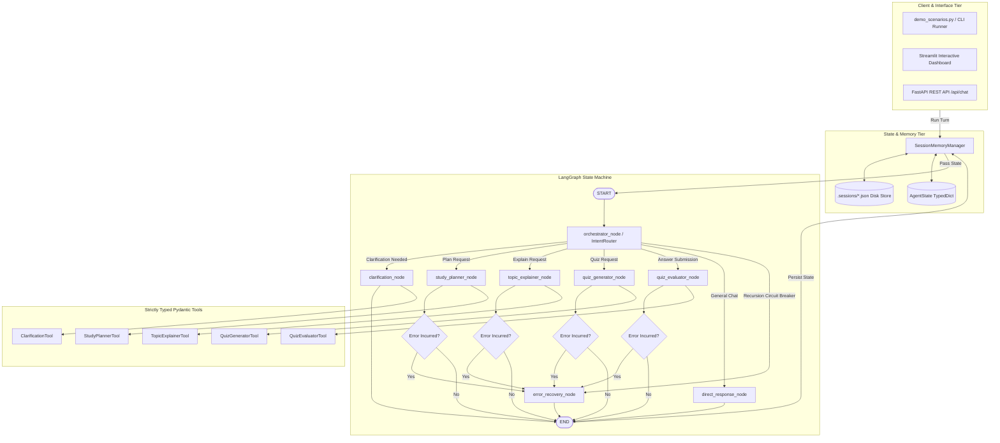

# System Architecture: Autonomous AI Study Assistant

This document outlines the architectural blueprint, state graph topology, component interactions, and resilience mechanisms of the Autonomous AI Study Assistant.

---

## 1. High-Level Architectural Diagram

The system is constructed as a cyclic state graph using **LangGraph**, where state flows through discrete operational nodes and conditional edge routers.

---

## 2. Core Architectural Components

### 2.1 State Management (`AgentState`)
The agent's memory is defined as a strongly typed data structure tracking both pedagogical artifacts and execution metadata:

| State Field | Type | Description |
| :--- | :--- | :--- |
| `session_id` | `str` | Unique student session identifier. |
| `current_input` | `str` | Current turn's user message. |
| `conversation_history` | `List[Dict[str, str]]` | Complete history of user and assistant interactions. |
| `subject` | `Optional[str]` | Active academic subject (e.g., "Machine Learning"). |
| `current_topic` | `Optional[str]` | Active subtopic or concept focus. |
| `active_plan` | `Optional[StudyPlan]` | Active structured roadmap with milestones and hours. |
| `active_quiz` | `Optional[Quiz]` | In-progress assessment containing questions, options, and keys. |
| `quiz_evaluation` | `Optional[QuizEvaluation]` | Diagnostic score, question feedback, and remediation. |
| `is_clarifying` | `bool` | True when the assistant is resolving an ambiguous query. |
| `execution_trace` | `List[Dict[str, Any]]` | Audit log containing each step, action, reasoning, and latency. |
| `recursion_counter` | `int` | Execution step counter to prevent runaway cycles. |
| `errors` | `List[str]` | Captured exceptions for self-healing error recovery. |

### 2.2 Intent Router & Decision Matrix
The Intent Router (`IntentRouter.route`) employs a hybrid decision policy:

1. **Deterministic Guardrails**:
   - *Recursion Limit Check*: If `recursion_counter >= 12`, immediately route to `error_recovery_node` to break infinite loops.
   - *Answer Submission Detection*: If `active_quiz` is present and student input matches answer patterns (`q1: B, q2: A` or options), route deterministically to `quiz_evaluator_node`.
   - *Clarification Resolution*: If `is_clarifying` is active and student provides a subject/topic, automatically transition to `study_planner_node`.
   - *Ambiguity Check*: If query lacks domain context and is under 4 words or matches vague prompts (`help me study`), route to `clarification_node`.
2. **LLM Semantic Classification**:
   - For nuanced, mixed, or natural language prompts, the LLM classifies intent into `ActionType` (`plan`, `explain`, `quiz_generate`, `quiz_evaluate`, `clarify`, `direct_response`).
   - Every decision produces an explicit `reasoning` justification explaining the choice.

### 2.3 Isolated Tool Hierarchy (`BaseTool`)
All tools inherit from `BaseTool[InputSchema, OutputSchema]`:
- **Input & Output Validation**: Strict Pydantic parsing guarantees that tools receive valid parameters and emit compliant JSON.
- **Automated Retries**: Configured with exponential backoff (`max_tool_retries = 2`).
- **Simulated Chaos Injection**: Supports `simulate_failure` for reliable failure testing.

---

## 3. Workflow Control & Conditional Edges

1. **`route_from_orchestrator`**:
   Dispatches from `orchestrator` to specific worker nodes (`study_planner`, `topic_explainer`, `quiz_generator`, `quiz_evaluator`, `clarification`, `direct_response`, `error_recovery`).
2. **`route_after_tool`**:
   Evaluates tool execution health. If any unhandled exception occurred, diverts state to `error_recovery_node` instead of terminating abruptly.
3. **`error_recovery_node`**:
   Inspects captured stack traces, preserves student state, formulates actionable user-facing guidance, and safely routes to `END`.
