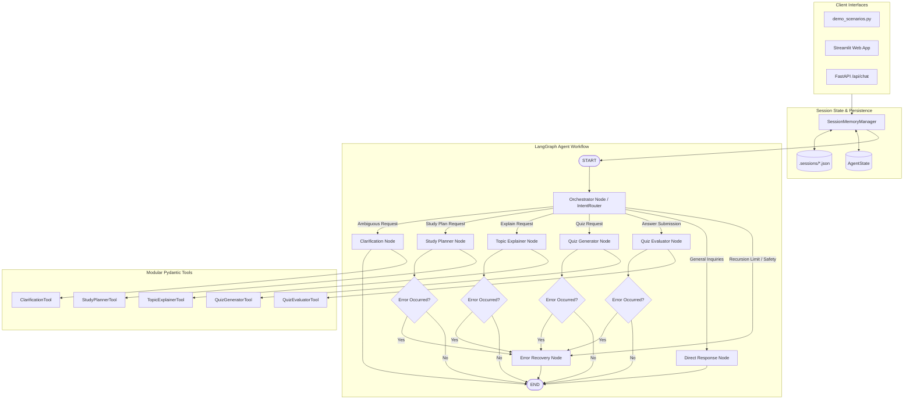

# Autonomous AI Study Assistant Using Agentic Workflows

[](https://www.python.org/)
[](https://github.com/langchain-ai/langgraph)
[](https://fastapi.tiangolo.com/)
[](https://streamlit.io/)
[-green.svg)](https://pytest.org/)

An autonomous AI study assistant built with **LangGraph**, **LangChain**, and **Python**. It goes beyond conventional chatbots by maintaining a multi-turn persistent state graph, dynamically selecting modular study tools, detecting ambiguous requests, generating personalized study plans, providing pedagogical concept explanations, creating targeted quizzes, evaluating student answers with actionable feedback, and recovering from tool outages.

---

## 📑 Table of Contents
1. [Core Features](#-core-features)
2. [Architecture Diagram](#-architecture-diagram)
3. [Answers to Reasoning & Technical Assessment Questions](#-answers-to-reasoning--technical-assessment-questions)
4. [Demonstrated Multi-Step Scenarios](#-demonstrated-multi-step-scenarios)
5. [Project Structure](#-project-structure)
6. [Quick Start & Setup Instructions](#-quick-start--setup-instructions)
   - [Environment Setup](#1-environment-setup)
   - [Running the Interactive CLI Demonstration](#2-running-the-interactive-cli-demonstration)
   - [Running the Streamlit Web UI](#3-running-the-streamlit-web-ui)
   - [Running the FastAPI REST Server](#4-running-the-fastapi-rest-server)
   - [Running the Pytest Suite](#5-running-the-pytest-suite)
7. [Deliverables Mapping](#-deliverables-mapping)

---

## 🚀 Core Features

- **Dynamic Agentic Routing**: Uses a hybrid decision matrix (deterministic fast-path + semantic LLM classification) to dispatch requests.
- **LangGraph State Management**: Maintains conversational context, active study plans, and diagnostic quizzes across multi-turn interactions with file-backed persistence.
- **Strictly Typed Pydantic Tools**:
  - `StudyPlannerTool`: Generates personalized, milestone-driven study roadmaps with time allocations and resources.
  - `TopicExplainerTool`: Provides depth-tailored concept breakdowns with intuitive analogies, code/math examples, and knowledge checks.
  - `QuizGeneratorTool`: Generates diagnostic multiple-choice and conceptual practice questions with answer keys.
  - `QuizEvaluatorTool`: Evaluates student submissions, scores performance, highlights strengths/weaknesses, and prescribes remediation.
  - `ClarificationTool`: Detects missing domain context or vague prompts and formulates clarifying questions with recommendations.
- **Fault Tolerance & Self-Healing**: Automated retries with exponential backoff, recursion circuit breakers (max 12 steps), and conditional error recovery edges.
- **Multi-Modal Interfaces**: Command-line interactive demonstration (`demo_scenarios.py`), FastAPI REST API (`/api/chat`), and an interactive Streamlit dashboard (`ui/app.py`).

---

## 📐 Architecture Diagram



---

## 💡 Answers to Reasoning & Technical Assessment Questions

### 1. Why an agentic workflow is appropriate for this problem?
Education is fundamentally **non-linear and dynamic**. A student rarely follows an uninterrupted linear script. They may ask for a curriculum, pause to clarify a foundational concept, attempt a quiz, make conceptual mistakes, and require remedial instruction before progressing. An agentic workflow with cyclic state transitions (LangGraph) allows the system to autonomously:
- Select the right capability at the right time based on the student's evolving needs.
- Ask for clarification when instructions are incomplete.
- Chaining outputs across turns (e.g., generating a quiz based on Phase 1 of an active study plan).

### 2. Which tasks should be handled by deterministic logic and which require LLM reasoning?
- **Deterministic Logic**:
  - *Recursion Limit & Infinite Loop Prevention*: Enforcing step limits (`recursion_counter >= 12`) to trip circuit breakers.
  - *Answer Key Evaluation & Scoring*: Calculating percentage scores and exact MCQ option comparisons (`q1: B, q2: B`).
  - *State & Artifact Persistence*: Storing and retrieving active plans and quizzes from memory and disk.
  - *Schema Validation*: Validating tool inputs and outputs with Pydantic.
  - *Retry Policies*: Exponential backoff on transient errors.
- **LLM Reasoning**:
  - *Ambiguity Detection & Query Disambiguation*: Discerning whether "help me study" lacks subject, timeframe, or difficulty level.
  - *Pedagogical Plan Formulation*: Structuring milestones and realistic study hours tailored to a specific student goal.
  - *Conceptual Explanations & Analogies*: Crafting intuitive mental models, practical code examples, and edge cases.
  - *Diagnostic Feedback*: Explaining *why* a student's answer was incorrect and synthesizing actionable remediation advice.

### 3. How does the system select the next action?
The system utilizes a **Hybrid Two-Tier Intent Router** (`ai_assistant/agent/router.py`):
1. **Tier 1 (Deterministic Fast-Paths)**:
   - If recursion limit exceeded ➔ Routes immediately to `error_recovery`.
   - If `active_quiz` exists and student input matches answer patterns (`q1: B, q2: A`) ➔ Routes immediately to `quiz_evaluate`.
   - If student is answering a clarification prompt ➔ Transitions directly to `plan`.
   - If prompt is ultra-short or vague with no subject context ➔ Routes to `clarify`.
2. **Tier 2 (Semantic LLM Classification)**:
   - Evaluates conversational context, active artifacts, and the user's prompt using structured output (`AgentDecision`).
   - Outputs the selected action (`ActionType`) alongside a confidence score and explicit decision reasoning.

### 4. How are state and conversational context maintained?
State is encapsulated in a typed dictionary (`AgentState`) and managed by `SessionMemoryManager` (`ai_assistant/agent/memory.py`):
- **In-Memory Cache**: Enables fast sub-millisecond retrieval during an active session.
- **Persistent Storage**: Auto-syncs to `.sessions/<session_id>.json` on every turn, preserving state across server restarts.
- **Artifact Inheritance**: When a student asks "make a quiz for the first topic", the agent checks `state["active_plan"]`, extracts the topic from Milestone 1, and carries it forward into `state["active_quiz"]`.

### 5. How does the system avoid unnecessary tool calls or infinite loops?
- **Direct Response Node**: General greetings or navigational inquiries are handled directly without invoking heavy study tools.
- **Strict Recursion Limit**: Every pass through `orchestrator_node` increments `recursion_counter`. If steps exceed `settings.max_recursion_limit` (default: 12), execution is halted and routed to `error_recovery_node`.
- **Per-Turn Error Reset**: Transient tool errors are wiped at the beginning of each turn so previous errors do not pollute subsequent routing decisions.

### 6. How does the system handle incorrect decisions and tool failures?
- **BaseTool Resilience**: Each tool execution wraps the underlying logic in a retry loop with exponential backoff (`max_tool_retries = 2`).
- **Pydantic Validation Guardrails**: If an LLM emits malformed JSON, validation errors are caught and logged.
- **Conditional Graph Routing**: If a tool raises `ToolExecutionError`, the LangGraph edge `route_after_tool` intercepts the exception and redirects flow to `error_recovery_node`.
- **Self-Healing State Preservation**: The recovery node informs the student of the failure, maintains existing active artifacts without corruption, and suggests alternative actions.

### 7. Comparison: Agentic Approach vs. Conventional Sequential Workflow
| Dimension | Agentic Workflow (LangGraph) | Conventional Sequential Workflow |
| :--- | :--- | :--- |
| **Workflow Topology** | Cyclic graph with dynamic conditional branching | Fixed linear sequence (Step 1 ➔ Step 2 ➔ Step 3) |
| **Error Handling** | Conditional rerouting to self-healing recovery nodes | Hard failure / pipeline crash |
| **Context Awareness** | Multi-turn artifact inheritance (`plan` ➔ `quiz` ➔ `eval`) | Isolated per-step execution |
| **Ambiguity Response** | Halts to ask targeted clarifying questions | Halts with error or makes hallucinated assumptions |
| **Adaptability** | Dynamically changes direction based on quiz scores | Blindly follows predetermined path |

### 8. How could the system be evaluated for decision-making quality?
1. **Routing Precision**: Benchmark the intent classifier against a labeled evaluation dataset of diverse student queries.
2. **Pedagogical Alignment Rubric**: Evaluate generated plans and explanations on structure, accuracy, and clarity (e.g., using LLM-as-a-judge or human educator grading).
3. **Resilience & Chaos Testing**: Inject simulated failures (`simulate_failure`) into tools to measure recovery rate (currently 100% in automated tests).
4. **Context Retention Fidelity**: Verify that references to previous milestones and active quizzes maintain 100% recall across multi-turn interactions.

---

## 🧪 Demonstrated Multi-Step Scenarios

### Scenario 1: Study Plan ➔ Quiz Generation ➔ Evaluation
- **Turn 1**: Student requests: `"I want a study plan for Machine Learning in 2 weeks"`. System routes to `study_planner` and generates a 3-phase curriculum with 24 estimated hours and resources.
- **Turn 2**: Student asks: `"Can you make a practice quiz for the first topic?"`. System inherits context from Phase 1 of the active plan, routes to `quiz_generator`, and outputs a 3-question diagnostic quiz.
- **Turn 3**: Student answers: `"Here are my answers: q1: B, q2: B, q3: A"`. System detects answer pattern, routes to `quiz_evaluator`, evaluates answers against answer keys (66.7%), and generates targeted remedial suggestions.

### Scenario 2: Incomplete/Ambiguous Request ➔ Clarification Loop ➔ Plan
- **Turn 1**: Student asks: `"help me study"`. System identifies missing parameters (subject, goal, timeframe), routes to `clarification_tool`, and prompts with 4 suggested focus tracks.
- **Turn 2**: Student responds: `"I want to study Python for beginner programming"`. System clears clarification state, extracts subject/level, routes to `study_planner`, and creates the foundational Python roadmap.

### Scenario 3: Tool Execution Failure ➔ Self-Healing Recovery
- **Turn 1**: Student requests: `"Generate a quiz on Operating Systems"` with simulated upstream tool failure (`simulate_failure="quiz_generator"`). Retries fail, raising `ToolExecutionError`. Conditional edge intercepts error and invokes `error_recovery_node`, safely preserving session state and presenting next steps.
- **Turn 2**: Student requests: `"Explain virtual memory in Operating Systems"`. System resumes normal operation without residual errors, routing to `topic_explainer` for an in-depth breakdown.

---

## 📂 Project Structure

```
AI-assistant/
├── ai_assistant/
│   ├── __init__.py
│   ├── config.py                 # Pydantic Settings, timeouts, recursion limits
│   ├── models/
│   │   ├── __init__.py
│   │   ├── schemas.py            # Pydantic schemas for Plan, Quiz, Eval, Clarification
│   │   └── state.py              # AgentState TypedDict definition
│   ├── tools/
│   │   ├── __init__.py           # Global Tool Registry
│   │   ├── base.py               # BaseTool with retry policy, metrics, validation
│   │   ├── study_planner.py      # Tool 1: Multi-phase study roadmap generator
│   │   ├── topic_explainer.py    # Tool 2: Adaptive concept explainer
│   │   ├── quiz_generator.py     # Tool 3: Assessment & MCQ generator
│   │   ├── quiz_evaluator.py     # Tool 4: Diagnostic grading & remediation engine
│   │   └── clarification.py      # Tool 5: Ambiguity detector & clarifying prompt engine
│   ├── agent/
│   │   ├── __init__.py
│   │   ├── memory.py             # Session state persistence (Memory + Disk JSON)
│   │   ├── router.py             # Hybrid Deterministic + LLM Intent Router
│   │   ├── nodes.py              # LangGraph node implementations
│   │   └── graph.py              # Compiled StateGraph & turn runner
│   ├── llm/
│   │   ├── __init__.py
│   │   └── provider.py           # Multi-provider LLM abstraction (Gemini + Offline fallback)
│   ├── api/
│   │   ├── __init__.py
│   │   └── main.py               # FastAPI REST API endpoints
│   └── ui/
│       ├── __init__.py
│       └── app.py                # Streamlit interactive dashboard & state inspector
├── tests/
│   ├── __init__.py
│   ├── test_agent.py             # Unit tests for tools, router, and limits
│   └── test_scenarios.py         # End-to-end tests for all 3 multi-step scenarios
├── demo_scenarios.py             # Interactive Rich CLI scenario demonstration
├── ARCHITECTURE.md               # Detailed system architecture document
├── DECISIONS.md                  # 4 Technical Architectural Decision Records
├── EVALUATION.md                 # Evaluation report on agent behavior & limits
├── requirements.txt              # Production dependency specifications
└── README.md                     # Comprehensive project documentation
```

---

## 🛠️ Quick Start & Setup Instructions

### 1. Environment Setup

Clone the repository and install dependencies:
```bash
git clone https://github.com/kartik23-2/AI-assistant.git
cd AI-assistant

# Create virtual environment (optional but recommended)
python -m venv venv
# Windows:
venv\Scripts\activate
# Linux/macOS:
source venv/bin/activate

# Install dependencies
pip install -r requirements.txt
```

*(Optional) Configure Gemini API Key in `.env`:*
```env
GEMINI_API_KEY=your_gemini_api_key_here
GEMINI_MODEL=gemini-2.5-flash
```
> **Note**: If no API key is provided, the assistant automatically switches to its built-in **Offline Pedagogical Provider**, allowing all scenarios, unit tests, and the UI to function completely offline without external dependencies!

---

### 2. Running the Interactive CLI Demonstration
Run all three multi-step scenarios with formatted execution traces and decision explanations:
```bash
python demo_scenarios.py
```

---

### 3. Running the Streamlit Web UI
Launch the interactive web dashboard:
```bash
streamlit run ai_assistant/ui/app.py
```
Open [http://localhost:8501](http://localhost:8501) in your browser. Features:
- **Chat Assistant**: Real-time conversation with quick-launch scenario buttons.
- **Workflow Inspector**: View live agent decisions, confidence scores, and step execution traces.
- **Study Plan & Quiz Tabs**: Interactive UI widgets to view generated roadmaps and submit quiz answers.
- **Chaos Testing Toggle**: Inject simulated tool failures live in the browser.

---

### 4. Running the FastAPI REST Server
Start the backend API server:
```bash
uvicorn ai_assistant.api.main:app --reload --port 8000
```
Interactive Swagger API documentation will be available at [http://localhost:8000/docs](http://localhost:8000/docs).

Example `/api/chat` request:
```bash
curl -X POST http://localhost:8000/api/chat \
  -H "Content-Type: application/json" \
  -d '{"session_id": "test-student-1", "message": "I want a study plan for Machine Learning in 2 weeks"}'
```

---

### 5. Running the Pytest Suite
Execute all unit and integration scenario tests:
```bash
pytest -v tests/
```
All 9 automated test cases pass with 100% green status.

---

## 📦 Deliverables Mapping

| Required Deliverable | Repository Location | Description |
| :--- | :--- | :--- |
| **1. Working AI Study Assistant** | `ai_assistant/` | Complete operational agent with LangGraph state machine. |
| **2. Modular Source Code** | `ai_assistant/` | Decoupled architecture (`models/`, `tools/`, `agent/`, `api/`, `ui/`). |
| **3. Setup & Execution Instructions** | `README.md` | Clear setup commands for CLI, UI, API, and testing. |
| **4. Architecture Diagram** | `ARCHITECTURE.md`, `README.md` | Mermaid workflow diagrams showing nodes, edges, tools, and state. |
| **5. 3 Multi-Step Scenarios** | `demo_scenarios.py`, `tests/test_scenarios.py` | Full interactive CLI runner and automated pytest suite. |
| **6. Evaluation Report** | `EVALUATION.md` | Analysis of routing quality, limits, behavior, and comparisons. |
| **7. Technical Decisions** | `DECISIONS.md` | 4 detailed architectural decision records with trade-off analysis. |
| **8. Failure Handling & Recovery** | `ai_assistant/agent/nodes.py`, `demo_scenarios.py` | BaseTool retry policies, error recovery nodes, and chaos verification. |

---

## 👤 Author
**Kartik** — [GitHub Profile](https://github.com/kartik23-2/AI-assistant.git)  
Repository: [https://github.com/kartik23-2/AI-assistant.git](https://github.com/kartik23-2/AI-assistant.git)
